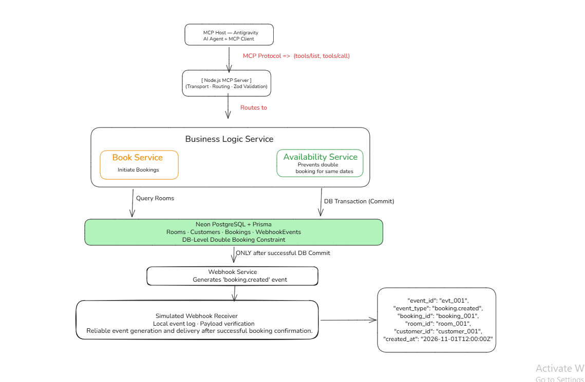

# Şema 1 — MCP ilə Otel Rezervasiya Arxitekturası



> İnteraktiv versiya: [1.html](1.html) — brauzerdə aç, qutulara klik et, "Axını göstər" düyməsi ilə addım-addım izlə.

## Qısaca nə deyir?

Bir **AI agent** (Antigravity) otel otağı rezerv etmək istəyir. O, birbaşa bazaya getmir — **MCP protokolu** ilə bizim **Node.js MCP Server**-ə müraciət edir. Server sorğunu yoxlayır, biznes məntiqinə ötürür, məntiq **PostgreSQL**-ə yazır, və **yalnız yazı uğurlu olduqdan sonra** `booking.created` webhook hadisəsi göndərilir.

Əsas fikir iki şeydir:
1. **Eyni otaq eyni tarixlərə iki dəfə satılmamalıdır** (double booking qadağası).
2. **Webhook yalnız rezervasiya həqiqətən bazaya yazılandan sonra** getməlidir.

---

## Yuxarıdan aşağı — hər qutu nə deməkdir

### 1. MCP Host — Antigravity (AI Agent + MCP Client)
- **Antigravity** — AI agentin işlədiyi mühitdir (IDE / agent platforması).
- **MCP Host** = agenti işlədən proqram. İçində **MCP Client** var — serverə qoşulan hissə.
- Agent özü "otağı necə rezerv edim" bilmir; o, serverdən hansı **tool**-ların olduğunu soruşur və onları çağırır.

### 2. Ox: `MCP Protocol => (tools/list, tools/call)`
MCP (Model Context Protocol) JSON-RPC əsaslı protokoldur. Burada iki əsas metod var:
| Metod | Nə edir |
|---|---|
| `tools/list` | "Hansı alətlərin var?" — server tool adlarını, təsvirlərini və input schema-larını qaytarır |
| `tools/call` | "Bu aləti bu parametrlərlə işə sal" — məs. `book_room({ room_id, check_in, check_out })` |

### 3. Node.js MCP Server (Transport · Routing · Zod Validation)
Serverin üç vəzifəsi:
- **Transport** — mesajların necə gəldiyi: `stdio` (lokal proses) və ya HTTP/SSE.
- **Routing** — gələn `tools/call`-un adına baxıb düzgün handler-ə göndərmək (`book_room` → Book Service).
- **Zod Validation** — parametrləri yoxlamaq. Məs. tarix düzgün formatdadırmı, `check_out > check_in`-mi, `room_id` boş deyilmi. Səhv giriş **biznes məntiqinə çatmadan** rədd edilir.

### 4. Ox: `Routes to`
Validasiyadan keçən sorğu biznes məntiqi qatına ötürülür.

### 5. Business Logic Service
Serverin "beyni". İki alt servis var:

- **Book Service (narıncı) — Initiate Bookings**
  Rezervasiyanı başladır: otağı tapır, müştərini tapır/yaradır, booking yazısını hazırlayır.

- **Availability Service (yaşıl) — Prevents double booking for same dates**
  Seçilmiş tarixlərdə otağın boş olub-olmadığını yoxlayır. Tarix aralıqları üst-üstə düşürsə (overlap) rezervasiyaya icazə vermir.
  Overlap qaydası: `yeni.check_in < mövcud.check_out VƏ yeni.check_out > mövcud.check_in`.

### 6. Oxlar: `Query Rooms` və `DB Transaction (Commit)`
- **Query Rooms** — otaqları və mövcud rezervasiyaları oxumaq (SELECT).
- **DB Transaction (Commit)** — rezervasiyanı bir **transaction** içində yazmaq. Ya hər şey yazılır (commit), ya heç nə (rollback). Yarımçıq vəziyyət olmur.

### 7. Neon PostgreSQL + Prisma
- **Neon** — bulud PostgreSQL xidməti. **Prisma** — Node.js-dən bazaya tip-təhlükəsiz müraciət edən ORM.
- Cədvəllər: `Rooms`, `Customers`, `Bookings`, `WebhookEvents`.
- **DB-Level Double Booking Constraint** — ən vacib hissə. Kodda yoxlama olsa belə, **bazanın özü** də eyni otaq üçün üst-üstə düşən tarixləri qadağan edir (məs. PostgreSQL `EXCLUDE USING gist (room_id WITH =, daterange(check_in, check_out) WITH &&)`).

> **Niyə həm kodda, həm bazada yoxlama?** Race condition üçün. İki sorğu eyni millisaniyədə gəlir → hər ikisi Availability yoxlamasında "boşdur" görür → hər ikisi yazmağa çalışır. Kod bunu tuta bilmir, amma bazanın constraint-i ikincini rədd edir. Kod yoxlaması = yaxşı səhv mesajı, baza constraint-i = son zəmanət.

### 8. Ox: `ONLY after successful DB Commit`
Webhook **yalnız commit uğurlu olduqdan sonra** yaranır. Əgər əvvəl göndərsəydik və sonra transaction rollback olsaydı, xarici sistem **mövcud olmayan rezervasiya** haqqında xəbər alardı ("phantom event").
`WebhookEvents` cədvəli hadisəni bazada saxlayır — göndərmə uğursuz olsa, təkrar cəhd etmək olur (Outbox pattern ideyası).

### 9. Webhook Service — Generates `booking.created` event
Commit-dən sonra hadisə obyektini qurur və alıcıya göndərir.

### 10. Simulated Webhook Receiver
Real xarici sistemi təqlid edən qəbuledici:
- **Local event log** — gələn hər hadisəni loga yazır (yoxlamaq üçün).
- **Payload verification** — payload-un düzgün və saxta olmadığını yoxlayır (məs. lazımi sahələr var, imza/HMAC uyğundur).
- Məqsəd: **etibarlı hadisə yaradılması və çatdırılması — yalnız uğurlu rezervasiyadan sonra**.

### 11. Payload nümunəsi (sağdakı qutu)
```json
{
  "event_id": "evt_001",
  "event_type": "booking.created",
  "booking_id": "booking_001",
  "room_id": "room_001",
  "customer_id": "customer_001",
  "created_at": "2026-11-01T12:00:00Z"
}
```
| Sahə | Mənası |
|---|---|
| `event_id` | Hadisənin unikal ID-si — alıcı eyni hadisəni iki dəfə emal etməsin (idempotency) |
| `event_type` | Hadisənin növü |
| `booking_id`, `room_id`, `customer_id` | Hansı rezervasiya, hansı otaq, hansı müştəri |
| `created_at` | Hadisənin vaxtı (UTC, ISO-8601) |

---

## Bir real nümunə — başdan sona

1. İstifadəçi agentə yazır: *"1–3 dekabr üçün room_001-i rezerv et."*
2. Agent `tools/list` ilə `book_room` tool-unu görür, sonra `tools/call` ilə çağırır.
3. MCP Server Zod ilə tarixləri yoxlayır → keçir.
4. Availability Service: 1–3 dekabrda room_001 boşdurmu? → boşdur.
5. Book Service transaction açır, `Bookings`-ə yazır, `WebhookEvents`-ə hadisə yazır → **COMMIT**.
6. Webhook Service `booking.created` göndərir.
7. Receiver payload-u yoxlayır, loga yazır.
8. Agent istifadəçiyə: *"Rezervasiya edildi, booking_001."*

**Alternativ:** eyni anda başqa agent də eyni otağı istəsə → baza constraint xətası → transaction rollback → webhook **göndərilmir** → agentə "otaq bu tarixlərdə doludur" qaytarılır.

## Yadda saxla
- MCP = agent ilə server arasında standart dil (`tools/list`, `tools/call`).
- Zod = qapıdakı mühafizəçi (səhv giriş içəri girmir).
- Double booking qorunması **iki qatlıdır**: kod + baza constraint.
- Webhook **commit-dən sonra**, heç vaxt əvvəl.

> Kiçik qeyd: şəkildə `Query Rooms` oxu Book Service-dən, `DB Transaction (Commit)` oxu Availability Service-dən çıxır. Məntiqi olaraq hər iki servis bazanı oxuyur, commit isə rezervasiyanı yazan servisdə baş verir — oxlar "hansı tip əməliyyat bazaya gedir" kimi oxunmalıdır.
