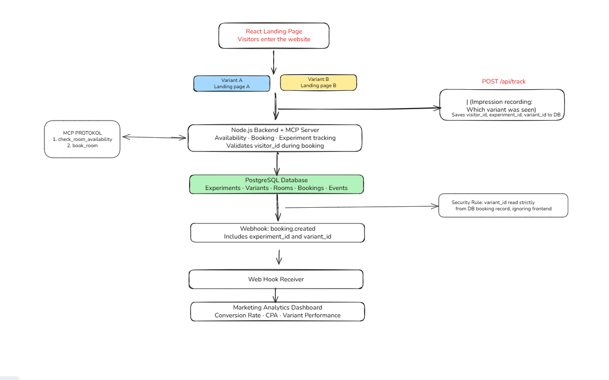

# Şema 2 — A/B Test (Experiment) + Rezervasiya + Marketinq Analitikası



> İnteraktiv versiya: [2.html](2.html) — brauzerdə aç, qutulara klik et, "Axını göstər" düyməsi ilə addım-addım izlə.

## Qısaca nə deyir?

Bu, Şema 1-in **marketinq ilə genişləndirilmiş** versiyasıdır. Saytın iki fərqli landing page variantı var (**A** və **B**). Hər ziyarətçiyə birini göstəririk, **kimin hansını gördüyünü** qeyd edirik, sonra rezervasiya edəndə bu rezervasiyanı **həmin variantla əlaqələndiririk**. Sonda dashboard-da hansı variantın daha çox satış gətirdiyini görürük.

Sual: **"Landing page A, yoxsa B daha çox rezervasiya gətirir?"**

---

## Yuxarıdan aşağı — hər qutu nə deməkdir

### 1. React Landing Page — Visitors enter the website
Ziyarətçi sayta daxil olur. Frontend React ilə yazılıb. Hər ziyarətçiyə bir **`visitor_id`** verilir (məs. cookie / localStorage-da saxlanılan unikal ID).

### 2. Variant A / Variant B
Eyni experiment-in iki versiyası. Məs.:
- **A** — mavi düymə, "İndi rezerv et"
- **B** — sarı düymə, "Son 3 otaq qaldı!"

Ziyarətçi təsadüfi şəkildə birinə düşür, və **həmişə eyni variantı görür** (hər dəfə dəyişməsin deyə təyinat yadda saxlanılır).

### 3. `POST /api/track` — Impression recording
**Impression** = "ziyarətçi bu variantı gördü" faktı.
Səhifə göstərilən kimi frontend backend-ə göndərir:
```json
{ "visitor_id": "v_123", "experiment_id": "exp_landing", "variant_id": "B" }
```
Backend bunu bazaya yazır. Bu, konversiya hesabının **məxrəcidir** (neçə nəfər gördü).

### 4. Node.js Backend + MCP Server
Bir backend, bir neçə iş:
- **Availability** — otaq boşdurmu?
- **Booking** — rezervasiya yaratmaq.
- **Experiment tracking** — impression-ları və variant təyinatlarını saxlamaq.
- **Validates visitor_id during booking** — rezervasiya zamanı gələn `visitor_id` bazada həqiqətən mövcuddurmu, impression qeydi varmı — yoxlanılır. Uydurma ID ilə rezervasiya experiment-ə bağlanmır.

### 5. MCP PROTOKOL (sol qutu, ikitərəfli ox)
Backend eyni zamanda MCP server kimi AI agentlərə iki tool açır:
1. `check_room_availability` — tarix aralığında otağın boş olub-olmadığını yoxlayır.
2. `book_room` — rezervasiya edir.

İkitərəfli ox = agent sorğu göndərir, server cavab qaytarır. Yəni rezervasiyanı həm sayt istifadəçisi, həm də AI agent edə bilər — eyni məntiq, eyni baza.

### 6. PostgreSQL Database
Cədvəllər:
| Cədvəl | Nə saxlayır |
|---|---|
| `Experiments` | Testlər (məs. `exp_landing`, başlama/bitmə tarixi) |
| `Variants` | Hər testin variantları (A, B) |
| `Rooms` | Otaqlar |
| `Bookings` | Rezervasiyalar — içində `visitor_id`, `experiment_id`, `variant_id` |
| `Events` | Impression-lar və webhook hadisələri |

### 7. Security Rule (sağ qutu) — ən vacib qayda
> *variant_id read strictly from DB booking record, ignoring frontend*

Webhook-a və analitikaya gedən `variant_id` **frontend-in göndərdiyi dəyərdən deyil, bazadakı qeyddən** götürülür.

**Niyə?** Frontend-ə etibar etmək olmaz — istifadəçi brauzerdə DevTools ilə `variant_id: "A"`-nı `"B"`-yə dəyişə bilər. Bu, test nəticələrini saxtalaşdırar. Ona görə backend `visitor_id`-yə görə bazada həmin ziyarətçinin **həqiqətən gördüyü** variantı tapır və rezervasiyaya onu yazır.

### 8. Webhook: `booking.created` — Includes experiment_id and variant_id
Şema 1-dəki kimi, rezervasiya commit olduqdan sonra hadisə göndərilir — amma indi içində experiment məlumatı da var:
```json
{
  "event_id": "evt_001",
  "event_type": "booking.created",
  "booking_id": "booking_001",
  "room_id": "room_001",
  "visitor_id": "v_123",
  "experiment_id": "exp_landing",
  "variant_id": "B",
  "created_at": "2026-11-01T12:00:00Z"
}
```

### 9. Web Hook Receiver
Hadisəni qəbul edir, yoxlayır, saxlayır və analitikaya ötürür.

### 10. Marketing Analytics Dashboard
Üç əsas göstərici:
| Göstərici | Düstur | Mənası |
|---|---|---|
| **Conversion Rate** | rezervasiya sayı ÷ impression sayı | Görənlərin neçə faizi rezerv etdi |
| **CPA** (Cost Per Acquisition) | marketinq xərci ÷ rezervasiya sayı | Bir rezervasiya bizə neçəyə başa gəldi |
| **Variant Performance** | A ilə B-nin müqayisəsi | Hansı variant qalibdir |

**Nümunə:**
- A: 1000 impression, 30 rezervasiya → **3%**
- B: 1000 impression, 45 rezervasiya → **4.5%**
- Reklam xərci hər biri üçün $300 → CPA A = $10, CPA B = $6.67 → **B qalibdir**.

---

## Bir real nümunə — başdan sona

1. Ziyarətçi sayta girir, `visitor_id = v_123` alır, **Variant B**-yə düşür.
2. Frontend `POST /api/track` göndərir → bazada "v_123 B-ni gördü" yazılır.
3. Ziyarətçi otaq seçir → backend `check_room_availability` məntiqi ilə yoxlayır → boşdur.
4. Ziyarətçi rezerv edir, sorğuda `visitor_id = v_123` (və bəlkə də saxta `variant_id = A`) gəlir.
5. Backend `v_123`-ü yoxlayır, bazadan **B** olduğunu tapır, frontend-in `A`-sını **görməzdən gəlir**.
6. Booking `variant_id = B` ilə yazılır → commit.
7. Webhook `booking.created` (experiment_id + variant_id ilə) göndərilir.
8. Receiver qəbul edir → dashboard-da B-nin konversiyası artır.

## Şema 1 ilə fərq
| | Şema 1 | Şema 2 |
|---|---|---|
| Kim rezerv edir | Yalnız AI agent (MCP) | Sayt ziyarətçisi + AI agent |
| Əlavə | — | A/B test, impression tracking |
| Webhook payload | booking məlumatı | + `experiment_id`, `variant_id` |
| Son nöqtə | Simulated receiver | Marketinq dashboard |
| Yeni təhlükəsizlik qaydası | DB double booking constraint | + variant_id yalnız bazadan |

## Yadda saxla
- **Impression** = gördü, **Conversion** = rezerv etdi.
- `visitor_id` ziyarətçini impression-dan rezervasiyaya qədər izləyən ipdir.
- **Frontend-ə etibar etmə** — variant həmişə bazadan oxunur.
- Webhook yenə **yalnız commit-dən sonra**.
